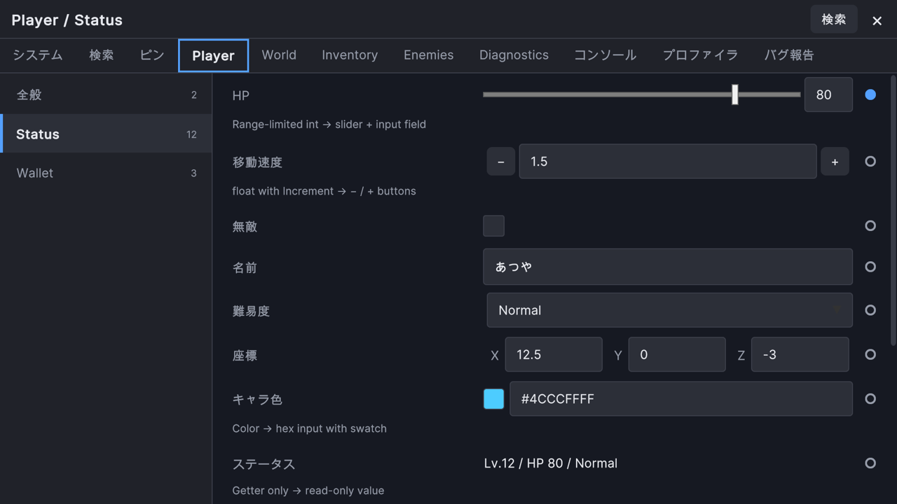
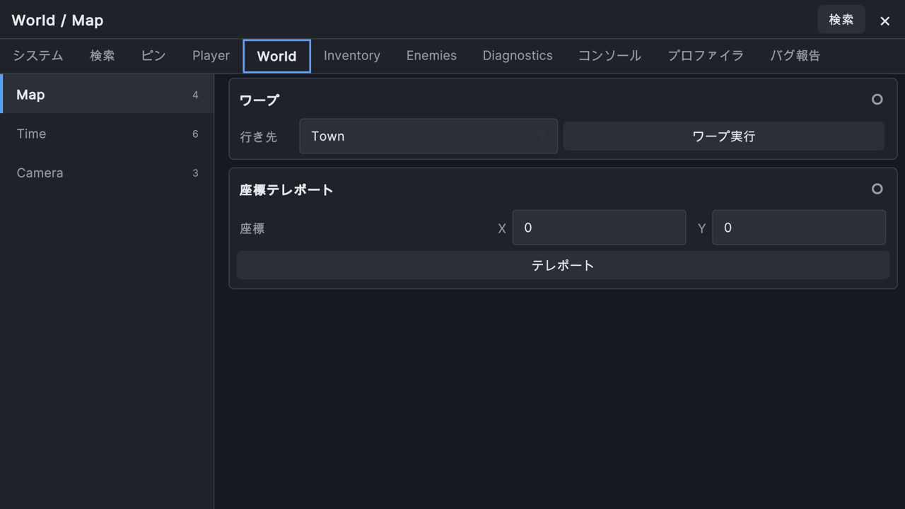
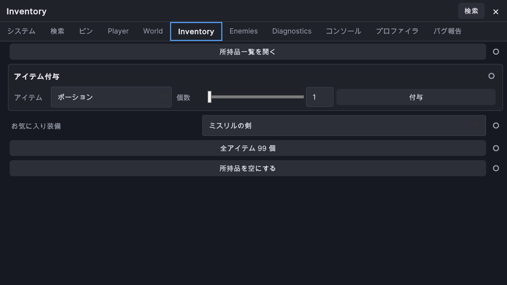
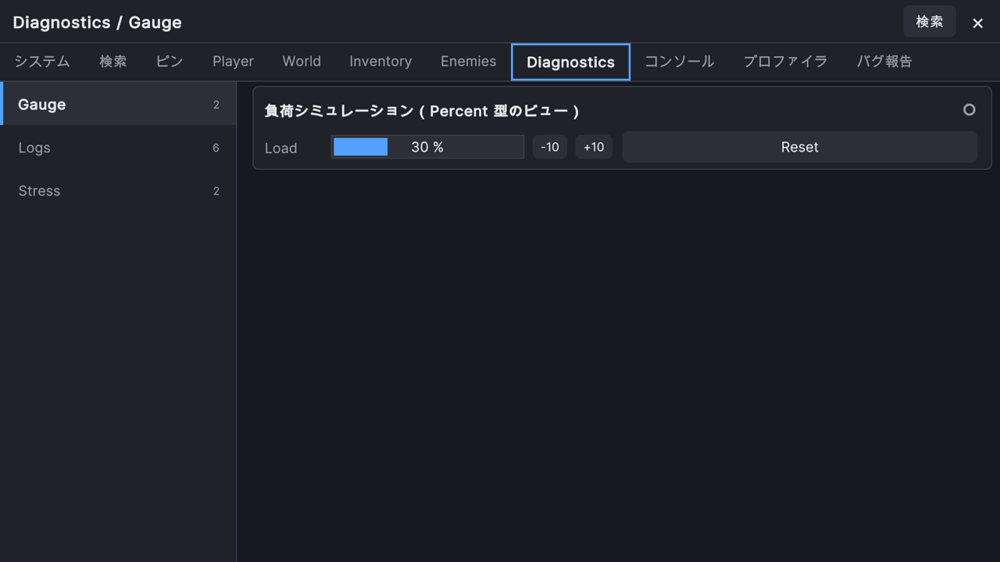
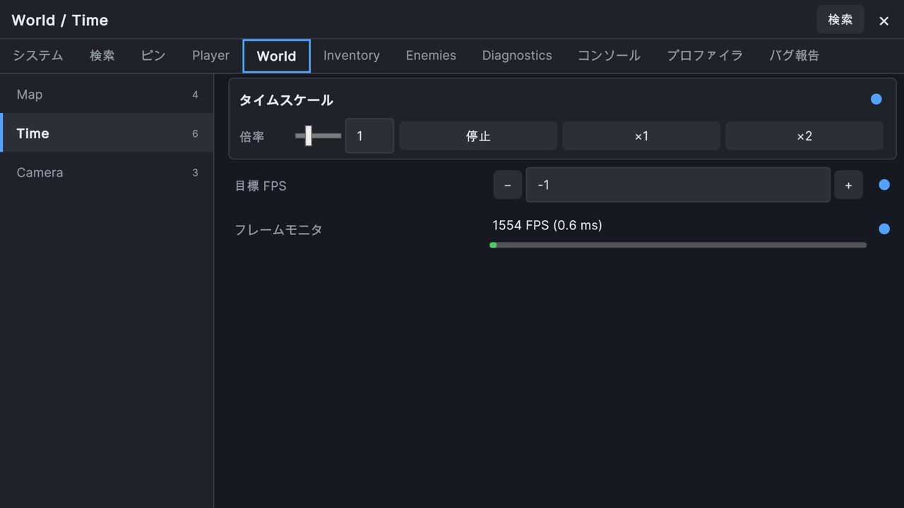
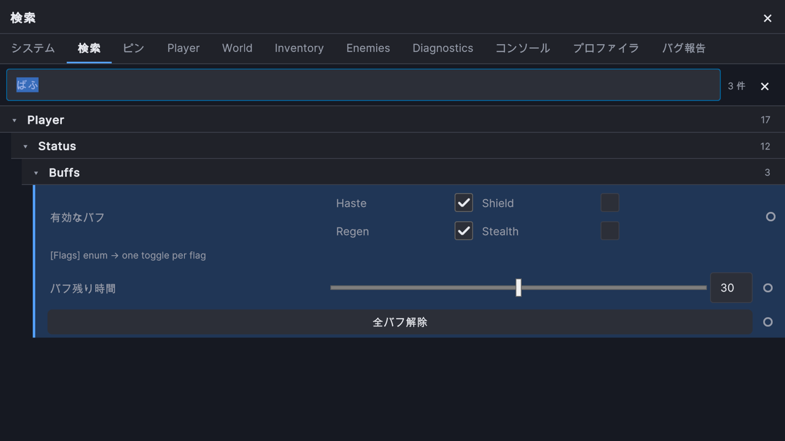
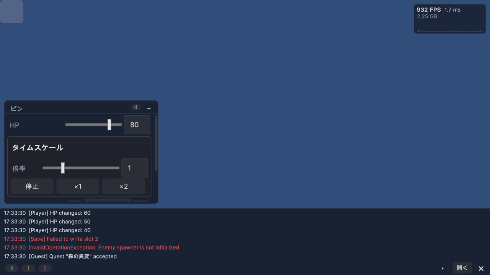
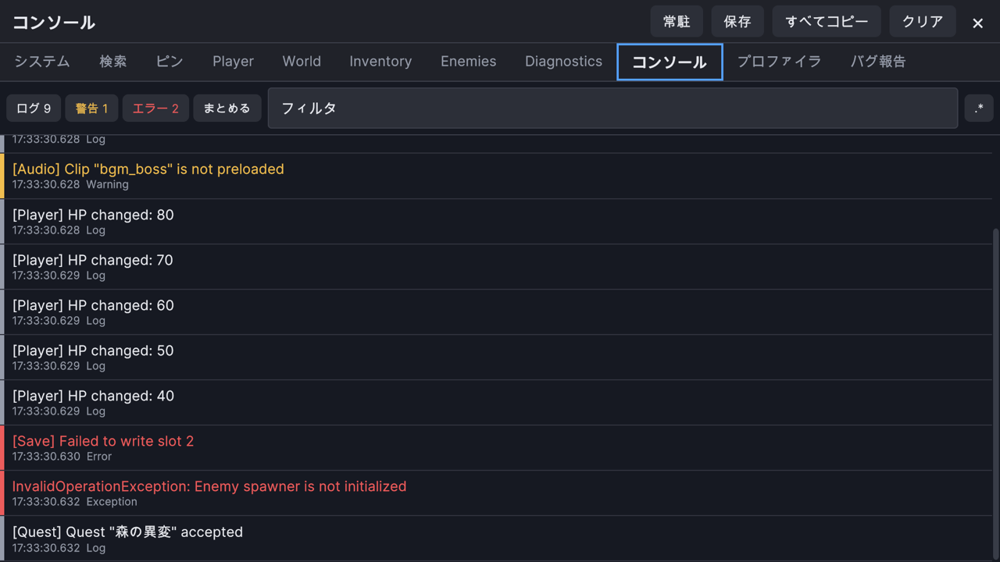
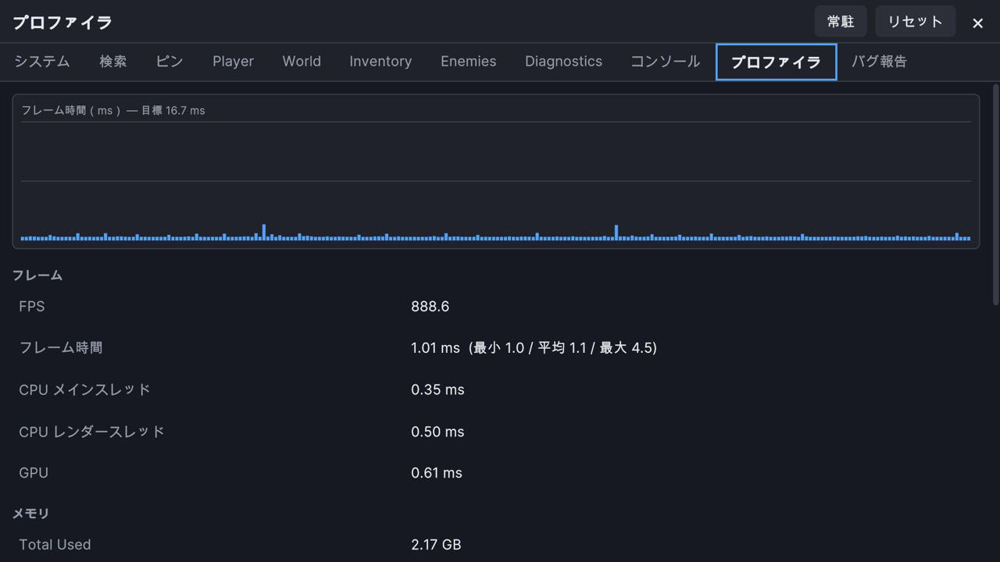
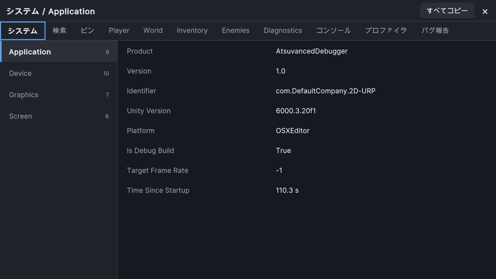

# Atsuvanced Debugger

**属性を付けるだけで、そのままデバッグメニューになる。** UI Toolkit で一から設計した、次世代のインゲームデバッガです。

書くのは数行、規模が大きくなっても重くならず、必要になればどこまでも作り込めます。

- 🏷️ **属性ベース**: プロパティ / メソッドに属性を付けると、型に合った UI（スライダー、トグル、ドロップダウン、ボタン…）が自動で生成されます
- 🧩 **差し替え自由**: テーマ → 型ごとのビュー → ページ → タブ → Feature と、必要な粒度だけ自作の UI に置き換えられます
- 🔌 **組み込みも拡張も同じ仕組み**: System / Console / Profiler などの組み込みタブや常駐表示も、すべて公開 API の上の Feature です。同じ API で追加・削除・置き換えができ、特別扱いの内部 UI はありません
- 📚 **大量データに強い**: オプション数千件・ログ数千件でも、仮想化した ListView で軽く動きます。値のポーリングは画面に出ている行だけです
- ♻️ **毎フレームの GC Alloc 0 B**: パネルを閉じている間も開いている間も、デバッガ自身は毎フレームのメモリ確保をしません
- 🔄 **動的な増減に追従**: オプション / カテゴリ / タブはいつでも増減でき、UI は差分で更新されて選択状態も保たれます
- 🔍 **横断検索**: ツリーの形を保ったまま絞り込み。日本語のかな / カナ、全角 / 半角を区別しません
- 📌 **ゲーム画面に常駐**: よく使う項目の Pin、ログ、FPS をパネルを閉じたまま表示
- 🐞 **バグ報告**: 説明・スクリーンショット（デバッグ UI を除いて撮影）・ログ・システム情報をまとめて保存 / 送信。送信先は差し替え可能
- 💾 **状態の保存**: Pin・開いていたタブ・オプションの値（`[OptionPersist]`）を次回の起動に引き継ぎます
- 🛡️ **壊れない**: 自作のページやビューで例外が起きても、その部分だけをエラー表示にしてパネル全体は動き続けます
- 🤝 **ゲームに干渉しない**: EventSystem を作らず、独自の UIDocument / PanelSettings で動きます。Resources も使いません
- 🚫 **リリースから完全に外せる**: シンボル 1 つで全 API が no-op になり、設定アセットもビルドから外れます
- 🌐 **英語 / 日本語 UI**: システム言語に合わせて自動で切り替わり、文言は個別に差し替えられます

> Unity 6（6000.0）以上 / Mono・IL2CPP 対応。

- API リファレンス: [Documentation~/API.md](Documentation~/API.md)

---

## このコードで、このメニューができます

### 1. クラスに属性を付けて登録する

```csharp
using Atsuvanced.Debugger;

[OptionCategory("Player")]                       // 1 階層目 = タブ
public sealed class PlayerOptions
{
    [OptionCategory("Status"), OptionName("HP"), NumberRange(0, 100)]   // 2 階層目 = 左の一覧
    [OptionDescription("Range-limited int → slider + input field")]
    public int Hp { get; set; } = 80;

    [OptionCategory("Status"), OptionName("移動速度"), Increment(0.25)]
    public float MoveSpeed { get; set; } = 1.5f;

    [OptionCategory("Status"), OptionName("無敵")]
    public bool Invincible { get; set; }

    [OptionCategory("Status"), OptionName("名前")]
    public string PlayerName { get; set; } = "あつや";

    [OptionCategory("Status"), OptionName("難易度")]
    public Difficulty Difficulty { get; set; } = Difficulty.Normal;

    [OptionCategory("Status"), OptionName("座標")]
    public Vector3 Position { get; set; } = new Vector3(12.5f, 0f, -3f);

    [OptionCategory("Status"), OptionName("キャラ色")]
    public Color Tint { get; set; } = new Color(0.3f, 0.8f, 1f);

    [OptionCategory("Status"), OptionName("ステータス")]
    public string Summary => $"Lv.{Level} / HP {Hp} / {Difficulty}";   // getter のみ → 読み取り専用

    [OptionName("全回復")]
    public void FullHeal() => Hp = 100;                                  // メソッド → ボタン
}

AtsuDebug.Instance.AddOptionContainer(new PlayerOptions());
```

型に合わせて UI が選ばれます。範囲付きの数値はスライダー + 入力欄、`Increment` 付きは − / + ボタン、enum はドロップダウン、`Vector3` は XYZ、`Color` は 16 進入力と色見本です。



パネルは **F1**、または画面左上を 3 回タップで開きます（設定で変更可）。コードからは `AtsuDebug.Instance.ShowDebugPanel("option:Player")` で開けます。

- 階層は「1 階層目 = タブ、2 階層目 = 左の一覧（セクション）、3 階層目以降 = 折り畳み」です。`OptionsFeature.Layout = OptionsLayout.SingleTab` にすると、1 つの Options タブにまとめられます
- オプション / カテゴリはいつでも増減できます。UI は差分で追従します

```csharp
AtsuDebug.Instance.AddOptionContainer(enemy, "Enemies/Goblin#3");   // カテゴリを指定して登録
AtsuDebug.Instance.RemoveOptionCategory("Enemies/Goblin#3");        // カテゴリごと削除
```

`MonoBehaviour` / `ScriptableObject` を `AddOptionContainer` した場合、オブジェクトが破棄されると自動で登録解除されます。

#### カテゴリの並び順

カテゴリは最初に現れた順に並びます。`[OptionCategorySort]` またはコードで順番を指定できます（1 階層目 = タブ、2 階層目 = セクションの順番にもなります）。

```csharp
[OptionCategory("Debug"), OptionCategorySort(-10)]          // このクラスのカテゴリを先頭へ
[OptionCategorySort("Debug/Advanced", 100)]                 // 子カテゴリの順番
public class DebugOptions { ... }

AtsuDebug.Instance.Options.SetCategorySortPriority("Cheats", -100);   // 小さいほど前
```

### 2. 入力欄 + 決定ボタンをひとまとめにする（グループ）

```csharp
[OptionCategory("World")]
public sealed class WorldOptions
{
    [OptionCategory("Map"), OptionGroup("warp", Label = "ワープ"), OptionName("行き先")]
    public StageName WarpTarget { get; set; } = new StageName("Town");   // 独自型 → 型のビュー（3. を参照）

    [OptionCategory("Map"), OptionGroup("warp"), OptionName("ワープ実行")]
    public void Warp() => Teleport(WarpTarget);                    // ボタンを押すまで WarpTarget は確定しない

    [OptionCategory("Map"), OptionGroup("teleport", Label = "座標テレポート", Layout = OptionGroupLayout.Vertical)]
    public Vector2 TeleportTo { get; set; }

    [OptionCategory("Map"), OptionGroup("teleport"), OptionName("テレポート")]
    public void Teleport() { /* ... */ }
}
```



「値 + プリセットのボタン」のように、押した瞬間に反映したいグループは `Commit = OptionGroupCommit.Immediate` にします。

```csharp
[OptionCategory("Time"), OptionGroup("timescale", Label = "タイムスケール", Commit = OptionGroupCommit.Immediate)]
[NumberRange(0, 4), OptionName("倍率")]
public float TimeScale { get => Time.timeScale; set => Time.timeScale = value; }

[OptionCategory("Time"), OptionGroup("timescale"), OptionName("停止")] public void Pause()  => Time.timeScale = 0f;
[OptionCategory("Time"), OptionGroup("timescale"), OptionName("×1")]   public void Normal() => Time.timeScale = 1f;
[OptionCategory("Time"), OptionGroup("timescale"), OptionName("×2")]   public void Fast()   => Time.timeScale = 2f;
```

### 3. 見た目を変えたいときは、型のビューを登録する

自動生成で足りないときは、**型ごとに** ビュー（`OptionView`）を登録します。見た目を変える方法はこれだけです。オプションごとに描画を指定したり、UI 要素を直接差し込んだりする方法はありません。

見た目を変えたい値は、意味ごとの型（割合、ステージ名、アイテム ID…）にします。同じ意味の値は、どのオプションでも同じ見た目になります。オプション側に描画用の属性は要りません。

```csharp
// 起動前に、型とビューの組を登録する
AtsuDebug.Configure(b => b
    .AddOptionView<ItemId>(() => new ItemIdView())
    .AddOptionView<StageName>(() => new StageNameView())
    .AddOptionView<Percent>(() => new PercentView())
    .AddOptionView<FrameStats>(() => new FrameStatsView()));
```

**ドロップダウンで選ぶ型**（`ItemId`。2. の `StageName` も同じ作りです）

```csharp
public sealed class ItemIdView : OptionView
{
    private DropdownField _dropdown;

    public override VisualElement CreateElement(OptionContext context)       // 行ごとに 1 回
    {
        _dropdown = new DropdownField(ItemId.Names.ToList(), 0);
        _dropdown.RegisterValueChangedCallback(e => context.SetValue(new ItemId(_dropdown.index)));
        return _dropdown;
    }

    public override void Refresh(OptionContext context) =>                   // 値が変わったとき / 表示中のポーリング
        _dropdown.SetValueWithoutNotify(context.GetValue<ItemId>().ToString());
}

[OptionGroup("give", Label = "アイテム付与"), OptionName("アイテム")]
public ItemId GiveItem { get; set; }

[OptionName("お気に入り装備")]
public ItemId Favorite { get; set; }
```



**ゲージで見せる型**（`Percent`）。書き込みは `OptionContext` 経由なので、グループの確定方式（ボタンを押すまで保留など）も守られます。

```csharp
public readonly struct Percent
{
    public readonly int Value;
    public Percent(int value) => Value = Mathf.Clamp(value, 0, 100);
}

public sealed class PercentView : OptionView
{
    private ProgressBar _bar;

    public override VisualElement CreateElement(OptionContext context)
    {
        var root = new VisualElement();
        root.Add(_bar = new ProgressBar { lowValue = 0, highValue = 100 });
        root.Add(new Button(() => context.SetValue(new Percent(context.GetValue<Percent>().Value - 10))) { text = "-10" });
        root.Add(new Button(() => context.SetValue(new Percent(context.GetValue<Percent>().Value + 10))) { text = "+10" });
        return root;
    }

    public override void Refresh(OptionContext context)       // 値が変わったとき / 表示中のポーリング（0.3 秒ごと。割り当てを避ける書き方は API.md の OptionContext）
    {
        var p = context.GetValue<Percent>();
        _bar.value = p.Value;
        _bar.title = p.Value + " %";
    }
}

[OptionCategory("Gauge"), OptionGroup("load", Label = "負荷シミュレーション", Commit = OptionGroupCommit.Immediate)]
public Percent Load { get; set; } = new Percent(30);

[OptionCategory("Gauge"), OptionGroup("load"), OptionName("Reset"), OptionSort(1)]
public void ResetLoad() => Load = new Percent(0);
```



**読み取り専用の値** にも使えます。getter だけのプロパティでも、`Refresh` が表示中に呼ばれ続けるので、常に最新の値を表示できます。

```csharp
[OptionCategory("Time"), OptionName("フレームモニタ")]
public FrameStats FrameMonitor => FrameStats.Current;    // FrameStatsView が FPS とバーを描く
```



- カスタム描画は `OptionContext.Placement == OptionPlacement.Pinned` で Pin 用の見た目に切り替えられます
- 組み込みの描画を包んで拡張したいとき（例: `float` の組み込みスライダーの横にリセットボタンを足す）は `OptionViewRegistry.CreateDefault(definition)` で組み込みのビューを作れます
- 型を登録すると、その型のプロパティがオプションになります（登録前は対応していない型として無視されます）。実行中は `AtsuDebug.Instance.OptionViews.Register<T>` / `Unregister(type)` でも登録できます
- ビューで例外が起きても、その行だけがエラー表示になり、パネル全体は壊れません

### 4. 全オプションを横断検索する

**検索** タブ（`Ctrl+F`、設定で変更可）で、すべてのオプションをツリーの形のまま絞り込めます。かな / カナ、全角 / 半角は区別しないので、「ばふ」で「バフ」がヒットします。

```csharp
var results = new List<OptionSearchResult>();
AtsuDebug.Instance.Options.Search("ばふ", results);   // コードからも同じ検索ができる
```



### 5. ゲーム画面に常駐させる（Pin / Docked Console / Docked Profiler）

パネルを閉じている間も、よく使うオプション・最新のログ・FPS を画面の隅に出しておけます。

```csharp
var d = AtsuDebug.Instance;
d.PinOption("Player/Status/HP");                          // オプションを Pin（行の丸ボタンでも可）
d.PinAllOptions("World/Time");                            // カテゴリごと Pin
d.GetFeature<DockedConsoleFeature>().IsVisible = true;    // 最新のログを画面下に
d.GetFeature<DockedProfilerFeature>().IsDocked = true;    // FPS / ms / メモリを画面の隅に
```



**Pin**
- グループは Pin でもひとまとまりで表示されます
- 位置（四隅）・幅・最大の高さ・透明度は設定アセットの **Pinned Options** で変更します
- 見出し（**Pinned** と件数）をタップすると最小化 / 復元します（状態は次回の起動でも保持）
- **Pinned** タブに Pin 中のオプションがツリーの形で並びます。行の丸ボタンで個別に外せます（外した行はパネルを閉じるまで残るので、押し直せば戻せます）。ヘッダーの **Unpin All** は 2 回押すと全解除します（1 回目は確認表示、3 秒で戻る）。全解除は、今は登録されていないオプションの保存済みの Pin も消します
- 名前での Pin は同名のオプション（例: 敵の HP）すべてに当たります。`"Player/Status/HP"` のように Id（カテゴリ + 名前）で指定してください
- Pin は Id で覚えるので、後から登録されたオプション（再スポーンした敵など）にも自動で付きます

**Docked Console**（Console タブの **常駐** ボタンでも表示）

```csharp
var dock = AtsuDebug.Instance.GetFeature<DockedConsoleFeature>();
dock.Alignment = ConsoleAlignment.Top;
dock.IsExpanded = false;                        // 件数と最新の 1 行だけのバー
```

- バー（件数の部分）をタップで展開 / 折り畳み。行か **開く** で Console タブを開く。× で非表示
- 行数（高さ）・透明度・初期状態は設定アセットの **Docked Console** で変更します。表示 / 展開 / 位置は次回の起動でも保持します

**自作の常駐表示**: トリガー・Pin・Docked Console / Profiler はすべて `DebugOverlay` です。同じ仕組みで追加できます。

```csharp
public sealed class PingOverlay : DebugOverlay
{
    private Label _label;
    public PingOverlay() : base("ping", OverlayAnchor.TopRight, order: 20) { }

    public override bool IsActive => Network.IsConnected;            // 表示したいときだけ true（毎フレーム評価）
    protected override VisualElement CreateContent() => _label = new Label();
    protected override void OnUpdate(float dt) => _label.text = $"{Network.Ping} ms";
}

AtsuDebug.Instance.Overlays.Add(new PingOverlay());
```

- `OverlayAnchor` は四隅・上下中央と `TopEdge` / `BottomEdge`。同じ隅の表示は `Order` の小さい順に隅から積まれます（トリガーは -100、Docked Profiler は 10、Pin は 20）
- 常駐表示は重なりません。上下の辺にある Docked Console は全幅で、隅の表示を内側に押します
- 既定ではパネルを閉じている間だけ表示されます（`Visibility => OverlayVisibility.Always` でパネルの上にも出る）。PIN パッドの表示中はすべて隠れます

---

## 組み込みのタブ

`システム | 検索 | ピン | (オプションの 1 階層目のカテゴリ…) | コンソール | プロファイラ | バグ報告`

| Console | Profiler |
|---|---|
|  |  |
| ログの種類ごとの絞り込み、まとめ表示、正規表現フィルタ、保存 / コピー。仮想化しているので数千件でも軽い | フレーム時間のグラフ、CPU / GPU 時間、メモリ、描画カウンタ。任意の値を追加できる |

| System |
|---|
|  |
| アプリ・端末・グラフィックス・画面の情報。`SystemInfo` に項目を追加できる |

### Profiler

フレーム時間のグラフ、FPS、CPU（メイン / レンダースレッド）・GPU 時間、メモリ（Total Used / Reserved、GC Used / Reserved、GC Alloc / Frame）、描画（Draw Calls / Batches / SetPass / Triangles / Vertices）が出ます。値の記録はタブか常駐表示が出ている間だけ行います。

```csharp
var profiler = AtsuDebug.Instance.Profiler;
profiler.AddCounter("Enemies", () => enemies.Count, ProfilerUnit.Count, "Game");                    // 任意の値
profiler.AddCounter("Physics Bodies", ProfilerCategory.Physics, "Active Dynamic Bodies");            // ProfilerRecorder のカウンタ
```

- GPU 時間は Player Settings の **Frame Timing Stats** が必要です。描画のカウンタは Development Build（または Editor）でのみ取れます。取れない値は「取得不可」と表示されます

### Bug Report

説明・メールアドレス・スクリーンショット（デバッグ UI を除いて撮影）・コンソールのログ・システム情報（`IsPrivate` の項目は除外）をまとめて送ります。既定では `Application.persistentDataPath/AtsuvancedDebugger/BugReports/<日時>/` に `report.txt` / `report.json` / `screenshot.png` を保存します。

```csharp
AtsuDebug.Instance.BugReports.Reporter = new MyReporter();   // IBugReporter で送信先を差し替え（起動前なら UseBugReporter。HTTP のサンプルあり）
AtsuDebug.Instance.ShowBugReportSheet(sent => Debug.Log(sent), takeScreenshot: true, description: "ここに説明");
AtsuDebug.Instance.Panel.CaptureScreenshot(png => File.WriteAllBytes(path, png));   // デバッグ UI を除いた画面
```

---

## 独自のページ・タブを足す

```csharp
public sealed class NetworkPage : DebugPage
{
    public NetworkPage() : base("Network") { }

    protected override VisualElement CreateContent() => new Label("任意の UI Toolkit 要素");
    protected override VisualElement CreateToolbar() => new Button(Reconnect) { text = "Reconnect" };
    protected override float UpdateInterval => 0.5f;
    protected override void OnUpdate() { /* 表示中だけ呼ばれる */ }
}

// タブとして追加（1 ページのタブ）
AtsuDebug.Instance.Tabs.Add(new DebugTabDefinition("network", "Network", () => new NetworkPage()));

// セクション（左の一覧）を持つタブ
var tools = new DebugTabDefinition("tools", "Tools");
tools.Sections.Add(new DebugSection("net", "Network", () => new NetworkPage()));
tools.Sections.Add(new DebugSection("save", "Save Data", () => new SaveDataPage()));
AtsuDebug.Instance.Tabs.Add(tools);

// 組み込みタブにもセクションを追加できる（System / Console / オプションカテゴリのタブ）
AtsuDebug.Instance.Tabs.Find("system").Sections.Add(new DebugSection("server", "Server", () => new ServerInfoPage()));
// 現在のタブに push（戻るボタンで戻れる）
AtsuDebug.Instance.PushPage(new NetworkPage());
// オプションのボタンから開く
AtsuDebug.Instance.AddOption(OptionDefinition.FromPage("Network", () => new NetworkPage(), "Tools"));
```

- パネルは上から「タブバー（右端に ×）→ ヘッダー（戻る / タイトル / `CreateToolbar` のツールバー）→ 内容」の順に並びます。1 ページだけのタブではタブ名と重なるのでタイトルを出さず、ツールバーもなければヘッダーごと隠れます
- `Chrome => PageChrome.None` でヘッダーとタブバーを隠し、パネル全面を使えます。`PageChrome.Header` だけにすると、× はヘッダーの右端に移ります
- `DebugPage.FromUxml(title, visualTreeAsset, dataSource)` で UXML から作れます（バインドするプロパティには `[Unity.Properties.CreateProperty]` が必要）
- 組み込みページは公開 API だけで作られています。自作ページでも同じ部品を使えます:
  - `Debugger.State` … 状態の永続化（キーには `"mygame/..."` のような接頭辞を付ける）
  - `OptionListView` … オプション一覧の埋め込み（`OnShow` で `Attach`、`OnHide` で `Detach`、`OnUpdate` で `Tick`、`OnDispose` で `Dispose`）
  - `Debugger.Profiler.BeginRecording()` … 表示中だけ Profiler を記録（戻り値を `Dispose` で終了）
  - `Debugger.BugReports.Pending` / `Complete(sent)` … `ShowBugReportSheet` に応える
  - `DebugPage.CreateErrorElement` … 失敗した部分のエラー表示、`UssClasses.Hidden` … 非表示のクラス

```csharp
public sealed class CheatsPage : DebugPage
{
    private OptionListView _list;
    public CheatsPage() : base("Cheats") { }

    protected override VisualElement CreateContent()
    {
        var root = new VisualElement();
        root.Add(new Button(() => Debugger.State.Set("mygame/cheats/used", "1")) { text = "Mark" });
        _list = new OptionListView(Debugger, "Cheats");
        root.Add(_list);
        return root;
    }

    protected override void OnShow() => _list.Attach();
    protected override void OnHide() => _list.Detach();
    protected override void OnUpdate() => _list.Tick(Time.unscaledDeltaTime);
    protected override void OnDispose() => _list.Dispose();
}
```

### 組み込みページを拡張する

`ConsolePage` / `SystemInfoPage` / `OptionSectionPage` / `OptionSearchPage` / `PinnedOptionsPage` / `ProfilerPage` / `BugReportPage`（`Atsuvanced.Debugger.UI`）は継承できます。差し替えは各 Feature の `PageFactory`（起動前）か、同じ id のセクションの登録（実行中）で行います。override するときは base を呼んでください。

```csharp
public sealed class MyConsolePage : ConsolePage
{
    protected override VisualElement CreateToolbar()
    {
        var bar = base.CreateToolbar();
        bar.Add(new Button(() => Debug.Log(Filter.Text)) { text = "Upload" });
        return bar;
    }
}

AtsuDebug.Configure(b => b.Configure<ConsoleFeature>(f => f.PageFactory = () => new MyConsolePage()));
// 実行中なら同じ id のセクションを登録し直す
AtsuDebug.Instance.Tabs.Find(DebugTabIds.Console)
    .Sections.Add(new DebugSection("logs", "Logs", () => new MyConsolePage()));
```

| ページ | Feature のプロパティ | タブ / セクション id |
|--------|----------------------|----------------------|
| `ConsolePage` | `ConsoleFeature.PageFactory` | `console` / `logs` |
| `ProfilerPage` | `ProfilerFeature.PageFactory` | `profiler` / `overview` |
| `BugReportPage`（`CreateReport` を override してデータを追加） | `BugReportFeature.PageFactory` | `bug-reporter` / `report` |
| `SystemInfoPage` | `SystemInfoFeature.PageFactory`（カテゴリごと） | `system` / `info:<カテゴリ>` |
| `OptionSearchPage`（`Query` で検索語を設定可） | `OptionsFeature.SearchPageFactory` | `search` / `options` |
| `PinnedOptionsPage` | `OptionsFeature.PinnedPageFactory` | `pinned` / `options` |
| `OptionSectionPage` | `OptionsFeature.SectionPageFactory`（すべてのセクション） | `option:<1 階層目>` / `opt:<2 階層目>`・`opt:<general>` |

---

## 構成を変える（Feature とメソッドチェーン）

URP が SRP の上に作られているのと同じように、組み込みのタブ・常駐表示・ショートカットはすべて **Feature**（`DebuggerFeature`）として公開 API の上に作られています。どの Feature を入れるかは、起動前に `DebuggerBuilder` のメソッドチェーンで決めます（既定はすべての組み込み Feature と設定アセットの値）。

```csharp
[RuntimeInitializeOnLoadMethod(RuntimeInitializeLoadType.AfterAssembliesLoaded)]
static void ConfigureDebugger() => AtsuDebug.Configure(b => b
    .ConfigureSettings(s => s.Trigger.Position = TriggerPosition.BottomRight)   // 設定アセットの値を上書き
    .UseStorage(new MyCloudStorage())                                         // 状態の保存先
    .UseBugReporter(new MyReporter())                                          // バグ報告の送信先
    .Remove<ProfilerFeature>()                                                 // Profiler タブを入れない
    .Configure<OptionsFeature>(f => f.Layout = OptionsLayout.SingleTab)        // オプションを 1 つのタブにまとめる
    .Configure<ConsoleFeature>(f => f.PageFactory = () => new MyConsolePage()) // 組み込みページを差し替え
    .AddOptionView<ItemId>(() => new ItemIdView())                             // 型ごとの描画
    .Add(new NetworkFeature()));                                               // 自作の Feature

public sealed class NetworkFeature : DebuggerFeature
{
    protected override void OnInstall()
    {
        Debugger.Tabs.Add(new DebugTabDefinition("network", "Network", () => new NetworkPage()));
        Debugger.Overlays.Add(new PingOverlay());
    }

    protected override void OnUninstall() => Debugger.Tabs.Remove("network");
}
```

| 組み込み Feature（`Atsuvanced.Debugger.UI`） | 内容 |
|---|---|
| `SystemInfoFeature` / `OptionsFeature` / `ConsoleFeature` / `ProfilerFeature` / `BugReportFeature` | 各タブ（`Order` と `PageFactory` で位置と中身を変更） |
| `TriggerFeature` / `PinnedOverlayFeature` / `DockedConsoleFeature` / `DockedProfilerFeature` | ゲーム画面上の常駐表示（オーバーレイ） |
| `KeyboardShortcutsFeature` / `PauseTimeFeature` | ショートカット、開いている間の一時停止 |

`ATSU_DEBUGGER_DISABLE_AUTO_INIT` を付けた場合は、`AtsuDebug.Init(b => ...)` で自分で初期化します。

---

## 設定

`Edit > Project Settings > Atsuvanced Debugger`（または `Tools > Atsuvanced Debugger > Project Settings`）で設定アセットを編集します。アセットは自動で作られ、Preloaded Assets に登録されます（Resources は使いません）。

- トリガー（位置・起動方式・サイズ）、エントリーコード（PIN）、言語（Auto / English / 日本語）、テーマ（Dark / Light）、ショートカット、Pin / Docked Console / Docked Profiler、バグ報告の保存先など
- 「Disable for current build target」で `ATSU_DEBUGGER_DISABLED` を切り替え（無効化したビルドからは設定アセットとテーマが外れます）
- 「Clear Saved State」で Pin や保存したオプションの値などを消去（実行時は `AtsuDebug.ClearSavedState()`）

### 言語・テーマ・操作

- 組み込み UI は英語 / 日本語（設定の **Language**、Auto はシステム言語）。`DebuggerStrings.Override(DebuggerLanguage.Japanese, "tab.console", "ログ")` で個別に差し替え可能
- テーマは Dark / Light（設定の **Theme**）。色は `--atsu-color-*` のカスタムプロパティで、Style Sheets に USS を足して上書きできます
- キーボード / ゲームパッド: パネルを開くとタブにフォーカスが入り、方向キー / スティックで移動、決定 / キャンセル（Escape・B ボタン）で戻る。`PageUp` / `PageDown`（ゲームパッドは L / R）でタブを切り替え

### エントリーコード（PIN）

設定の **Entry Code** をオンにすると、パネルを開く前に 4 桁の PIN を聞きます（一度通ればそのセッション中は聞かない。毎回聞く設定もあり）。

```csharp
AtsuDebug.Instance.Panel.SetEntryCode("2580");   // 起動前なら DebuggerBuilder.UseEntryCode("2580")
AtsuDebug.Instance.Panel.DisableEntryCode();
AtsuDebug.Instance.ShowDebugPanel(DebugTabIds.Console, requireEntryCode: false);   // コードからは PIN なしでも開ける
```

### 状態の保存

Pin、選択中のタブ / セクション、開いているカテゴリ、Search の直近の検索語は、次回の起動でも復元されます（既定は `PlayerPrefs`）。

- 保存先は `DebuggerBuilder.UseStorage`（`IDebuggerStorage`）で差し替えられます
- 保存しない場合は設定の `Persist State` をオフ
- 自作ページの状態も `AtsuDebug.Instance.State`（`Get` / `Set` / `Save`）に保存できます

`[OptionPersist]` を付けたプロパティは、変更のたびに値が保存され、次の起動で登録されたときに戻ります。

```csharp
[OptionCategory("Cheats"), OptionPersist]
public bool GodMode { get; set; }

[OptionPersist(Key = "speed-v1")]          // 名前やカテゴリを変えても引き継ぎたいとき
public float Speed { get; set; }

AtsuDebug.Instance.AddOption(OptionDefinition.Create("Volume", () => vol, v => vol = v, "Audio").WithPersistence());
```

- 対象の型: bool / 数値 / string / enum（Flags 含む）/ Vector2-4 / Color
- 保存した値は、コンテナを登録した時点で setter に書き込まれます
- 保存したものをすべて消すには `AtsuDebug.ClearSavedState()`（Project Settings の「Clear Saved State」も同じ）

---

## サンプル

Package Manager > Atsuvanced Debugger > Samples から Import できます。このページのスクリーンショットは **Options Showcase** を動かしたものです。

| サンプル | 内容 |
|---|---|
| Options Showcase | オプション機能の総まとめ（全組み込み型、3 階層、グループ、型ごとの描画、動的カテゴリ、ページ、ログ生成、負荷テスト） |
| Custom Page | 完全独自のページ、カスタムタブ、オプションからページを開く |
| Bug Report (HTTP) | バグ報告を自分のサーバへ POST する `IBugReporter`（JSON + テキスト + スクリーンショット） |

## Scripting Define Symbols

| Symbol | 効果 |
|--------|------|
| `ATSU_DEBUGGER_DISABLED` | 全 API を no-op 化（リリースビルド用）。設定アセットとテーマもビルドから外れる |
| `ATSU_DEBUGGER_DISABLE_AUTO_INIT` | 起動時の自動初期化を無効化 |
