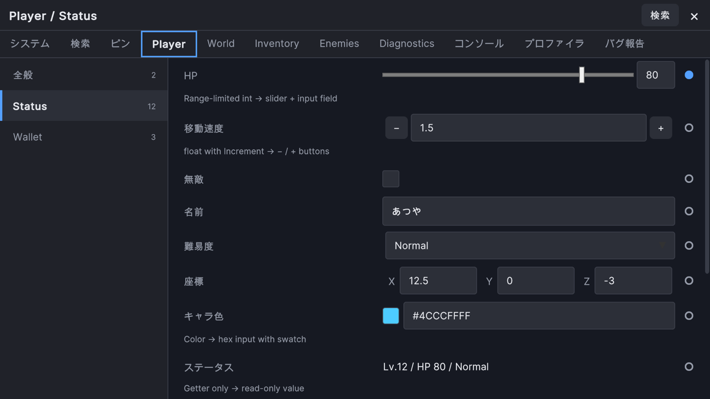
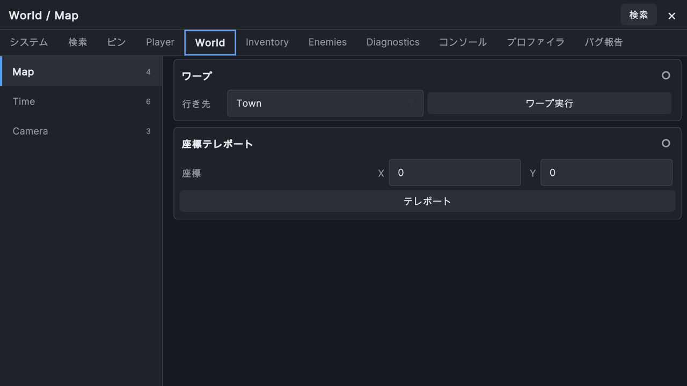
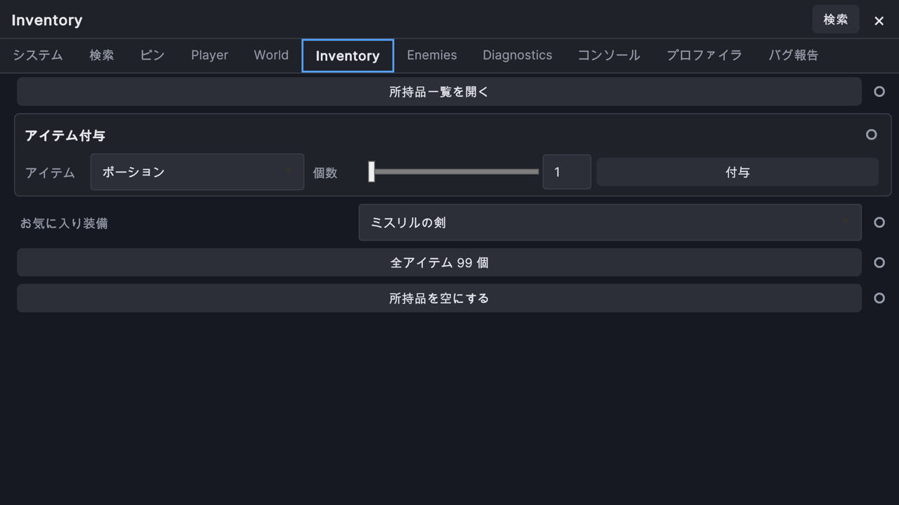
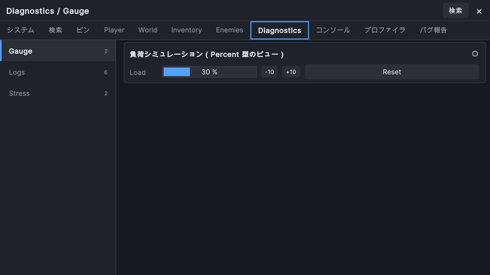
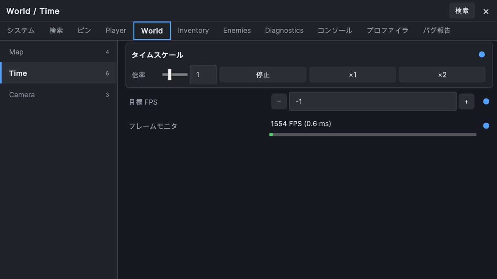
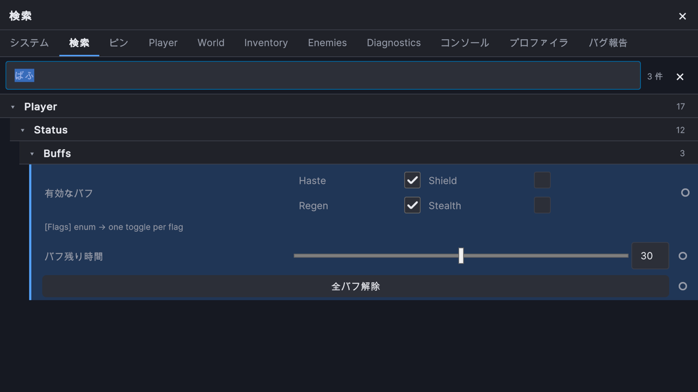
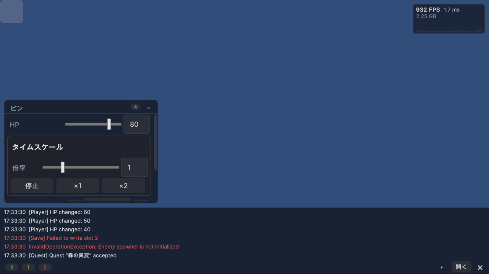
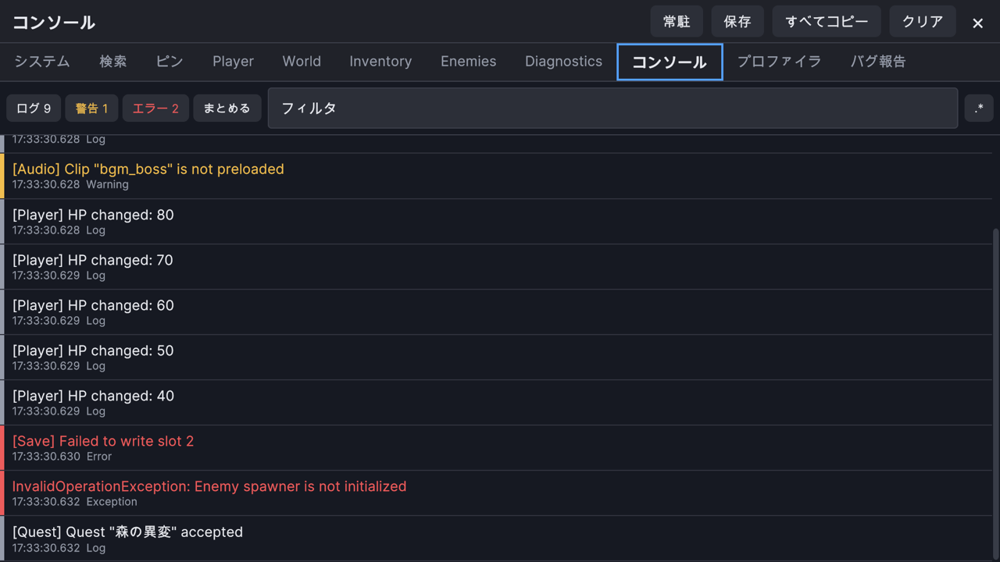
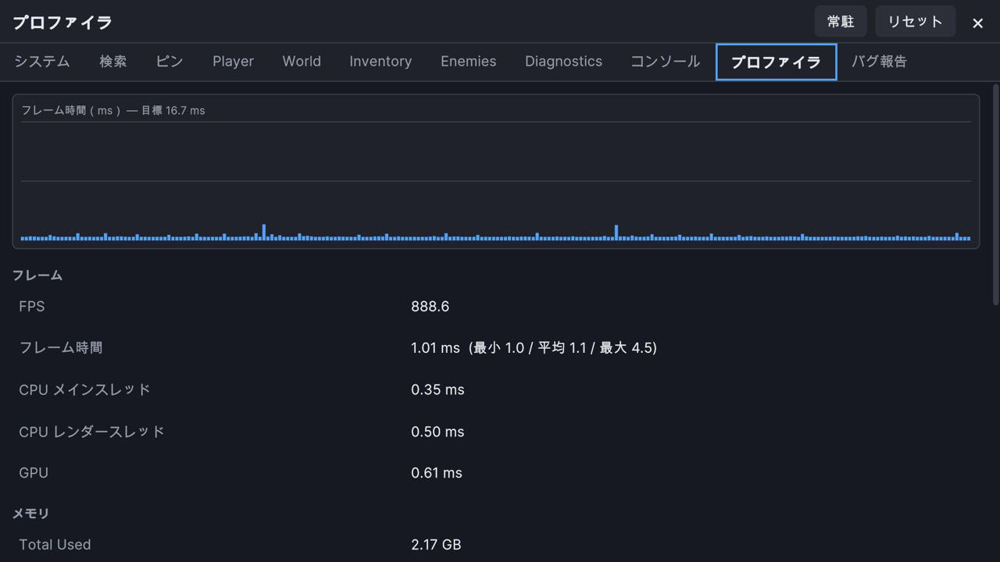
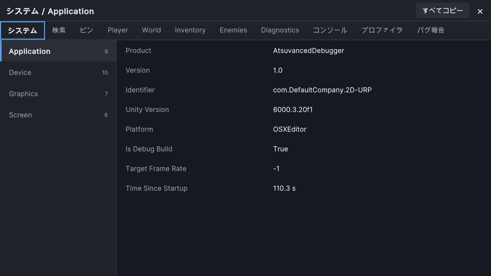

# Atsuvanced Debugger

**属性を付けるだけで、そのままデバッグメニューになる。** UI Toolkit で一から設計した、次世代のインゲームデバッガです。

書くのは数行、規模が大きくなっても重くならず、必要になればどこまでも作り込めます。

- 🏷️ **属性ベース**: プロパティ / メソッドに属性を付けると、型に合った UI（スライダー、トグル、ドロップダウン、ボタン…）が自動で生成されます
- 🧩 **差し替え自由**: テーマ → 型ごとのビュー → ページ → タブ → Feature と、必要な粒度だけ自作の UI に置き換えられます
- 🔌 **組み込みも拡張も同じ仕組み**: System / Console / Profiler などの組み込みタブや常駐表示も、すべて公開 API の上の Feature です。同じ API で追加・削除・置き換えができ、特別扱いの内部 UI はありません
- 📚 **大量データに強い**: オプション数千件・ログ数千件でも、仮想化した ListView で軽く動きます。値のポーリングは画面に出ている行だけです
- ♻️ **毎フレームの GC Alloc 0 B**: パネルを閉じている間も開いている間も、デバッガ自身は毎フレームのメモリ確保をしません
- 🔄 **動的な増減に追従**: オプション / カテゴリ / タブはいつでも増減でき、UI は差分で更新されて選択状態も保たれます
- 🔍 **横断検索**: ツリーの形を保ったまま絞り込み。日本語のかな / カナ、全角 / 半角を区別しません
- 📌 **ゲーム画面に常駐**: よく使う項目の Pin、ログ、FPS をパネルを閉じたまま表示
- 🐞 **バグ報告**: 説明・スクリーンショット（デバッグ UI を除いて撮影）・ログ・システム情報をまとめて保存 / 送信。送信先は差し替え可能
- 💾 **状態の保存**: Pin・開いていたタブ・オプションの値（`[OptionPersist]`）を次回の起動に引き継ぎます
- 🛡️ **壊れない**: 自作のページやビューで例外が起きても、その部分だけをエラー表示にしてパネル全体は動き続けます
- 🤝 **ゲームに干渉しない**: EventSystem を作らず、独自の UIDocument / PanelSettings で動きます。Resources も使いません
- 🚫 **リリースから完全に外せる**: シンボル 1 つで全 API が no-op になり、設定アセットもビルドから外れます
- 🌐 **英語 / 日本語 UI**: システム言語に合わせて自動で切り替わり、文言は個別に差し替えられます

> Unity 6（6000.0）以上 / Mono・IL2CPP 対応。本体は [`Packages/com.atsuvanced.debugger`](Packages/com.atsuvanced.debugger/) の UPM パッケージです。

---

## このコードで、このメニューができます

### 1. クラスに属性を付けて登録する

```csharp
using Atsuvanced.Debugger;

[OptionCategory("Player")]                       // 1 階層目 = タブ
public sealed class PlayerOptions
{
    [OptionCategory("Status"), OptionName("HP"), NumberRange(0, 100)]   // 2 階層目 = 左の一覧
    [OptionDescription("Range-limited int → slider + input field")]
    public int Hp { get; set; } = 80;

    [OptionCategory("Status"), OptionName("移動速度"), Increment(0.25)]
    public float MoveSpeed { get; set; } = 1.5f;

    [OptionCategory("Status"), OptionName("無敵")]
    public bool Invincible { get; set; }

    [OptionCategory("Status"), OptionName("名前")]
    public string PlayerName { get; set; } = "あつや";

    [OptionCategory("Status"), OptionName("難易度")]
    public Difficulty Difficulty { get; set; } = Difficulty.Normal;

    [OptionCategory("Status"), OptionName("座標")]
    public Vector3 Position { get; set; } = new Vector3(12.5f, 0f, -3f);

    [OptionCategory("Status"), OptionName("キャラ色")]
    public Color Tint { get; set; } = new Color(0.3f, 0.8f, 1f);

    [OptionCategory("Status"), OptionName("ステータス")]
    public string Summary => $"Lv.{Level} / HP {Hp} / {Difficulty}";   // getter のみ → 読み取り専用

    [OptionName("全回復")]
    public void FullHeal() => Hp = 100;                                  // メソッド → ボタン
}

AtsuDebug.Instance.AddOptionContainer(new PlayerOptions());
```

型に合わせて UI が選ばれます。範囲付きの数値はスライダー + 入力欄、`Increment` 付きは − / + ボタン、enum はドロップダウン、`Vector3` は XYZ、`Color` は 16 進入力と色見本です。



パネルは **F1**、または画面左上を 3 回タップで開きます（設定で変更可）。コードからは `AtsuDebug.Instance.ShowDebugPanel("option:Player")` で開けます。

### 2. 入力欄 + 決定ボタンをひとまとめにする（グループ）

```csharp
[OptionCategory("World")]
public sealed class WorldOptions
{
    [OptionCategory("Map"), OptionGroup("warp", Label = "ワープ"), OptionName("行き先")]
    public StageName WarpTarget { get; set; } = new StageName("Town");   // 独自型 → 型のビュー（3. を参照）

    [OptionCategory("Map"), OptionGroup("warp"), OptionName("ワープ実行")]
    public void Warp() => Teleport(WarpTarget);                    // ボタンを押すまで WarpTarget は確定しない

    [OptionCategory("Map"), OptionGroup("teleport", Label = "座標テレポート", Layout = OptionGroupLayout.Vertical)]
    public Vector2 TeleportTo { get; set; }

    [OptionCategory("Map"), OptionGroup("teleport"), OptionName("テレポート")]
    public void Teleport() { /* ... */ }
}
```



「値 + プリセットのボタン」のように、押した瞬間に反映したいグループは `Commit = OptionGroupCommit.Immediate` にします。

```csharp
[OptionCategory("Time"), OptionGroup("timescale", Label = "タイムスケール", Commit = OptionGroupCommit.Immediate)]
[NumberRange(0, 4), OptionName("倍率")]
public float TimeScale { get => Time.timeScale; set => Time.timeScale = value; }

[OptionCategory("Time"), OptionGroup("timescale"), OptionName("停止")] public void Pause()  => Time.timeScale = 0f;
[OptionCategory("Time"), OptionGroup("timescale"), OptionName("×1")]   public void Normal() => Time.timeScale = 1f;
[OptionCategory("Time"), OptionGroup("timescale"), OptionName("×2")]   public void Fast()   => Time.timeScale = 2f;
```

### 3. 見た目を変えたいときは、型のビューを登録する

自動生成で足りないときは、**型ごとに** ビュー（`OptionView`）を登録します。見た目を変える方法はこれだけです。オプションごとに描画を指定したり、UI 要素を直接差し込んだりする方法はありません。

見た目を変えたい値は、意味ごとの型（割合、ステージ名、アイテム ID…）にします。同じ意味の値は、どのオプションでも同じ見た目になります。オプション側に描画用の属性は要りません。

```csharp
// 起動前に、型とビューの組を登録する
AtsuDebug.Configure(b => b
    .AddOptionView<ItemId>(() => new ItemIdView())
    .AddOptionView<StageName>(() => new StageNameView())
    .AddOptionView<Percent>(() => new PercentView())
    .AddOptionView<FrameStats>(() => new FrameStatsView()));
```

**ドロップダウンで選ぶ型**（`ItemId`。2. の `StageName` も同じ作りです）

```csharp
public sealed class ItemIdView : OptionView
{
    private DropdownField _dropdown;

    public override VisualElement CreateElement(OptionContext context)       // 行ごとに 1 回
    {
        _dropdown = new DropdownField(ItemId.Names.ToList(), 0);
        _dropdown.RegisterValueChangedCallback(e => context.SetValue(new ItemId(_dropdown.index)));
        return _dropdown;
    }

    public override void Refresh(OptionContext context) =>                   // 値が変わったとき / 表示中のポーリング
        _dropdown.SetValueWithoutNotify(context.GetValue<ItemId>().ToString());
}

[OptionGroup("give", Label = "アイテム付与"), OptionName("アイテム")]
public ItemId GiveItem { get; set; }

[OptionName("お気に入り装備")]
public ItemId Favorite { get; set; }
```



**ゲージで見せる型**（`Percent`）。書き込みは `OptionContext` 経由なので、グループの確定方式（ボタンを押すまで保留など）も守られます。

```csharp
public readonly struct Percent
{
    public readonly int Value;
    public Percent(int value) => Value = Mathf.Clamp(value, 0, 100);
}

public sealed class PercentView : OptionView
{
    private ProgressBar _bar;

    public override VisualElement CreateElement(OptionContext context)
    {
        var root = new VisualElement();
        root.Add(_bar = new ProgressBar { lowValue = 0, highValue = 100 });
        root.Add(new Button(() => context.SetValue(new Percent(context.GetValue<Percent>().Value - 10))) { text = "-10" });
        root.Add(new Button(() => context.SetValue(new Percent(context.GetValue<Percent>().Value + 10))) { text = "+10" });
        return root;
    }

    public override void Refresh(OptionContext context)
    {
        var p = context.GetValue<Percent>();
        _bar.value = p.Value;
        _bar.title = p.Value + " %";
    }
}

[OptionCategory("Gauge"), OptionGroup("load", Label = "負荷シミュレーション", Commit = OptionGroupCommit.Immediate)]
public Percent Load { get; set; } = new Percent(30);

[OptionCategory("Gauge"), OptionGroup("load"), OptionName("Reset"), OptionSort(1)]
public void ResetLoad() => Load = new Percent(0);
```



**読み取り専用の値** にも使えます。getter だけのプロパティでも、`Refresh` が表示中に呼ばれ続けるので、常に最新の値を表示できます。

```csharp
[OptionCategory("Time"), OptionName("フレームモニタ")]
public FrameStats FrameMonitor => FrameStats.Current;    // FrameStatsView が FPS とバーを描く
```



### 4. 全オプションを横断検索する

**検索** タブ（`Ctrl+F`）で、すべてのオプションをツリーの形のまま絞り込めます。かな / カナ、全角 / 半角は区別しないので、「ばふ」で「バフ」がヒットします。

```csharp
var results = new List<OptionSearchResult>();
AtsuDebug.Instance.Options.Search("ばふ", results);   // コードからも同じ検索ができる
```



### 5. ゲーム画面に常駐させる（Pin / Docked Console / Docked Profiler）

パネルを閉じている間も、よく使うオプション・最新のログ・FPS を画面の隅に出しておけます。

```csharp
var d = AtsuDebug.Instance;
d.PinOption("HP");                                        // オプションを Pin（行の丸ボタンでも可）
d.PinAllOptions("World/Time");                            // カテゴリごと Pin
d.GetFeature<DockedConsoleFeature>().IsVisible = true;    // 最新のログを画面下に
d.GetFeature<DockedProfilerFeature>().IsDocked = true;    // FPS / ms / メモリを画面の隅に
```



自作の常駐表示も同じ仕組み（`DebugOverlay`）で追加できます。

```csharp
public sealed class PingOverlay : DebugOverlay
{
    private Label _label;
    public PingOverlay() : base("ping", OverlayAnchor.TopRight, order: 20) { }

    public override bool IsActive => Network.IsConnected;            // 表示したいときだけ true
    protected override VisualElement CreateContent() => _label = new Label();
    protected override void OnUpdate(float dt) => _label.text = $"{Network.Ping} ms";
}

AtsuDebug.Instance.Overlays.Add(new PingOverlay());
```

---

## 組み込みのタブ

オプション以外のタブも最初から入っています。

| Console | Profiler |
|---|---|
|  |  |
| ログの種類ごとの絞り込み、まとめ表示、正規表現フィルタ、保存 / コピー。仮想化しているので数千件でも軽い | フレーム時間のグラフ、CPU / GPU 時間、メモリ、描画カウンタ。任意の値を `Profiler.AddCounter` で追加できる |

| System |
|---|
|  |
| アプリ・端末・グラフィックス・画面の情報。`SystemInfo` に項目を追加できる |

**Bug Report** タブでは、説明・スクリーンショット（デバッグ UI を除いて撮影）・ログ・システム情報をまとめて保存 / 送信できます。送信先は `IBugReporter` で差し替えられます。

## 独自のページ・タブを足す

```csharp
public sealed class NetworkPage : DebugPage
{
    public NetworkPage() : base("Network") { }

    protected override VisualElement CreateContent() => new Label("任意の UI Toolkit 要素");
    protected override VisualElement CreateToolbar() => new Button(Reconnect) { text = "Reconnect" };
    protected override float UpdateInterval => 0.5f;
    protected override void OnUpdate() { /* 表示中だけ呼ばれる */ }
}

// タブとして追加
AtsuDebug.Instance.Tabs.Add(new DebugTabDefinition("network", "Network", () => new NetworkPage()));
// 組み込みのタブにセクションを足す
AtsuDebug.Instance.Tabs.Find("system").Sections.Add(new DebugSection("server", "Server", () => new ServerInfoPage()));
// オプションのボタンから開く
AtsuDebug.Instance.AddOption(OptionDefinition.FromPage("Network", () => new NetworkPage(), "Tools"));
```

## 構成を変える（Feature とメソッドチェーン）

組み込みのタブ・常駐表示・ショートカットは、すべて公開 API の上に作られた **Feature** です。起動前にメソッドチェーンで、入れる Feature と設定を決められます。

```csharp
[RuntimeInitializeOnLoadMethod(RuntimeInitializeLoadType.AfterAssembliesLoaded)]
static void ConfigureDebugger() => AtsuDebug.Configure(b => b
    .ConfigureSettings(s => s.Trigger.Position = TriggerPosition.BottomRight)  // 設定アセットの値を上書き
    .Remove<ProfilerFeature>()                                                // Profiler タブを入れない
    .Configure<OptionsFeature>(f => f.Layout = OptionsLayout.SingleTab)       // オプションを 1 つのタブにまとめる
    .Configure<ConsoleFeature>(f => f.PageFactory = () => new MyConsolePage())// 組み込みページを差し替え
    .UseBugReporter(new MyReporter())                                         // バグ報告の送信先
    .Add(new NetworkFeature()));                                              // 自作の Feature
```

## サンプル

Package Manager > Atsuvanced Debugger > Samples から Import できます。このページのスクリーンショットは **Options Showcase** を動かしたものです。

| サンプル | 内容 |
|---|---|
| Options Showcase | 全組み込み型、3 階層カテゴリ、グループ、型ごとの描画、動的カテゴリ、ページ、ログ生成、負荷テスト |
| Custom Page | 完全独自のページ、カスタムタブ、オプションからページを開く |
| Bug Report (HTTP) | バグ報告を自分のサーバへ POST する `IBugReporter` |

## リリースビルドから外す

Scripting Define Symbols に `ATSU_DEBUGGER_DISABLED` を付けると全 API が no-op になり、設定アセットとテーマもビルドから外れます（Project Settings > Atsuvanced Debugger の「Disable for current build target」で切り替え可）。

## ドキュメント

- [パッケージの README（機能の詳細）](Packages/com.atsuvanced.debugger/README.md)
- [API リファレンス](Packages/com.atsuvanced.debugger/Documentation~/API.md)
- [CHANGELOG](Packages/com.atsuvanced.debugger/CHANGELOG.md)
